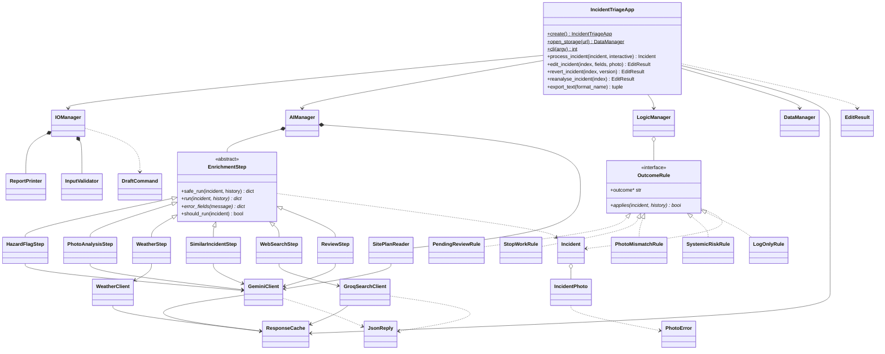
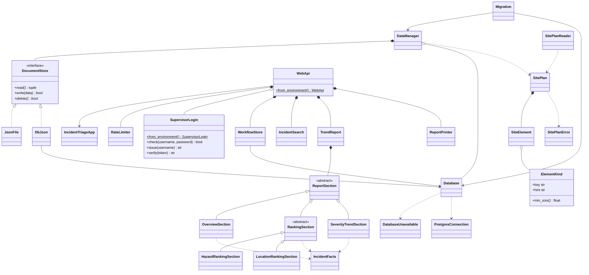

<!-- Sufi -->

# Workplace Safety Incident Triage System (Part 2, OOP)

INF1103 Team 6 (P11). A terminal app for construction-site supervisors in Singapore. A supervisor
logs an incident (now with an optional **photo of the scene**), AI gathers evidence, fixed business
rules score how serious it is, and the result is saved so safety officers can review the worst
incidents first. The AI gathers evidence; the rules make the final call.

Part 2 refactors the Part 1 procedural code into classes, keeps the four managers, and adds:

- **New feature: photo upload.** Gemini reads the photo and its findings feed the severity score.
- **Advanced feature: GUI.** A React web dashboard (`frontend/`, hosted on Netlify) talks to a Flask REST API
  (`web_api.py`, hosted on Render) that runs the same OOP pipeline as the terminal app.
- **2D site map.** Upload a picture of the site layout and the dashboard draws it as a pin board. Serious incidents
  (severity 3+) are pinned where they happened, with a heat glow on the busiest areas so the hotspots show at a glance.
  See [Site plan upload guide](templates/SITE_PLAN_UPLOAD_GUIDE.md).
- Also: the four evidence look-ups run at the same time in worker threads, and every passing push to `main`
  publishes the Docker image to GitHub Container Registry.

- **Login.** The dashboard opens on a login page; only whitelisted accounts can log in (there is no sign-up).
- **Priority and resolving.** Once logged in, you can set an incident's **priority**
  (P1 Urgent to P4 Low; the rules suggest one from the severity until someone sets it by hand), mark it **resolved** with a
  note, reopen it, delete it and use the triage queue on the **Log and Incident** page.
- **Search.** The search bar at the top of every page. On the **Overview** it shows ranked search results over every incident: words, `"exact phrases"` and `#12`, plus filters (severity, hazard, action,
  priority, open/resolved, dates, photo). Implemented in `search_engine.py`.
- **Trend and summary report (new feature).** Pick a period (7 to 90 days) and see it against the period before:
  how many incidents, how many severe, the average severity, what is still open, the busiest locations and hazard
  types, and a trend chart, with plain-language headlines and a CSV download. Implemented in `trend_report.py`:
  `TrendReport` owns a list of `ReportSection` objects (an abstract interface; `OverviewSection`,
  `HazardRankingSection`, `LocationRankingSection` and `SeverityTrendSection` implement it), so a new kind of block is a
  new subclass and `TrendReport` does not change (OCP, LSP). Tests: `tests/test_trend_report.py` (no live AI).
- **Database.** Optional. With `DATABASE_URL` set (a Postgres connection string, e.g. from [Neon](https://neon.com), or a
  SQLite file path), incidents, priority and resolved status, uploaded photos, the site plan and
  the AI cache all live in that database (`database.py`; the tables are created on first start), so nothing is lost when a
  server restarts. **Without it, or if the database cannot be reached, the app keeps working with local files in `data/`**
  and says so at start-up (`IncidentTriageApp.open_storage`), so the container runs for anyone with no set-up. Logs go to the
  console. To copy local data (`data/incidents.json`, `data/app.db`) into the database once, run
  `python migrate_to_database.py`.

## Setup

Python 3.11 or newer.

```bash
pip install -r requirements.txt
cp .env.example .env      # then put your own GEMINI_API_KEY and GROQ_API_KEY in .env
```

`.env` is never committed. `DATABASE_URL` is optional (see Database above). Without AI keys the app still runs, but every incident goes to manual review.

## Run

```bash
python main.py                                 # interactive menu
python main.py --batch tests/sample_batch.json # process a JSON list of incidents and exit
python main.py --export incidents.csv           # save every incident to a .csv or .json file and exit
```

Menu option 1 asks for the description, location, role and injury, then:

```
Attach a photo of the scene? Type or drag in the file path (.png .jpg .jpeg .webp, max 5 MB).
Photo path (or press Enter to skip):
```

In batch mode, add an optional `"photo_path"` to an item (relative to the batch file).

## Run the web dashboard (GUI) locally

Two terminals:

```bash
# 1. the API (http://127.0.0.1:8000)
python web_api.py

# 2. the React dashboard (http://127.0.0.1:5173)
cd frontend
npm install
npm run dev -- --host 127.0.0.1
```

Log in first (for example `darrel` / `123`, see [Login](#login)). Pages: **Overview** (stat cards, incidents-vs-severity chart, hazard donut, outcomes, recent incidents; type in the search
bar at the top to see ranked search results here), **Log and Incident** (the log form with photo drag & drop and the AI report,
with the triage queue of open incidents under it), **Incidents** (filter, click a row for the full report and photo, delete),
**Summary report**, **Site map** (the 2D pin board, see below, with the locations: query by place and days, and the saved places
under the map), **Severity guide**.

## 2D site map

Open **Site map** in the dashboard and upload a picture of the site layout (a top-down plan cropped to the site
boundary) with the real width of the picture in metres. The AI reads it, you check what it found on the map itself (click an area to rename it or change its type, drag it to move it, drag a corner to resize it) and the plan is saved.
From then on every incident whose location matches an area on the plan is pinned there. Try it with
one of the five sample site layouts in `templates/` (for example `templates/sample_site_plan.png` with a width of 90 m); the guide lists each file with its width.

How it works: the AI only locates and labels things on the picture (as 0-1000 coordinates). `SitePlanReader` converts them to
metres and `SitePlan` validates and fixes them. The ten kinds of area are listed in `ELEMENT_KINDS` (`site_plan/element_kinds.py`). Nothing is saved until the user confirms.
An incident is pinned on the element whose name or alias matches the incident's location.

| Class | Job |
|---|---|
| `ElementKind` | One kind of thing on a plan: its AI hint and minimum size. The ten kinds are objects of this one class, so a new kind is one new line in `ELEMENT_KINDS` |
| `SiteElement` / `SitePlan` | The validated plan. The plan owns its elements (composition) |
| `SitePlanReader` (in `ai_steps/`) | Prompt, schema, picture-to-metres conversion |
| `DataManager.save_site_plan` / `load_site_plan` | `data/site_plan.json`, with the same corrupt-file handling as the incidents |
| `frontend/src/components/SiteMap.jsx` / `SitePins.jsx` | The 2D SVG map: one shape per element kind, then the heat glow and severity pins on top |

Tests: `tests/test_site_plan.py` (no live AI).

## Deploy: backend on Render, frontend on Netlify

1. **Render** (API): New > Blueprint, pick this repo. `render.yaml` builds the Dockerfile and runs
   `gunicorn "web_api:create_app()"`. Fill in `GEMINI_API_KEY`, `GROQ_API_KEY`, and `FRONTEND_ORIGINS`
   (your Netlify address, e.g. `https://workplaceloggingsystem.netlify.app`). Check `https://<service>.onrender.com/api/health`.
2. **Netlify** (dashboard): Add new site > Import from GitHub, pick this repo. `netlify.toml` sets base `frontend`,
   build `npm run build`, publish `dist`. Add the environment variable `VITE_API_URL=https://<service>.onrender.com`
   and redeploy.

On Render's free plan the server sleeps after 15 idle minutes (the first request then takes about a minute) and
its disk is wiped on restart, so saved incidents are lost. Open the dashboard a minute before a demo.

| Endpoint | What it does |
|---|---|
| `GET /api/health` | Server is up, number of incidents (no login needed) |
| `POST /api/login` | JSON `{"username": "...", "password": "..."}`. 200 with a `token` (lasts 8 hours), 401 wrong details, 429 after 10 wrong tries (no login needed) |
| `GET /api/session` | The logged-in account's `username`, 401 if the token is missing or has run out |
| `GET /api/meta` | Severity levels, outcome and hazard names (same wording as the terminal) |
| `GET /api/incidents` | Every saved incident |
| `POST /api/incidents` | Multipart form: `description`, `location`, `reporter_role`, `injury`, optional `photo` file. 201 saved, 422 invalid or rejected by the AI, 429 rate limit |
| `GET /api/incidents/<n>` / `DELETE /api/incidents/<n>` | One incident / delete it |
| `PATCH /api/incidents/<n>` | Edit an incident and run the AI again. Same form fields (any left out keep their value) plus `remove_photo=true`. 200 `updated` (the replaced version is `history[-1]`) or `unchanged` (no AI call), 422 invalid or rejected, 502 AI failed (old version kept) |
| `POST /api/incidents/<n>/revert` | JSON `{"version": 1}`: copies an older version in as the newest one (no AI call) |
| `POST /api/incidents/<n>/reanalyse` | No body. Runs the AI again on the incident as saved and keeps the result as a new version (the old one stays in `history`); it ignores the saved AI replies. 200 `updated`, 404, 422 rejected, 429 rate limit, 502 AI failed (old version kept) |
| `GET /api/incidents/export` | Downloads every incident as a file for reference: `?format=csv` (default) or `json`. 422 for another format |
| `GET /api/incidents/<n>/photo` | The uploaded photo (`?version=N` for an older version's photo) |
| `GET /api/site-plan` / `PUT /api/site-plan` / `DELETE /api/site-plan` | The saved site plan (`PUT` takes the plan as JSON, 422 if unusable) |
| `POST /api/site-plan/read` | Multipart: `plan` image, `site_width_m`, optional `image_aspect` and `site_name`. Returns a draft plan (not saved). 422 bad form, 502 AI failed |
| `GET /api/incidents/search` | `q` plus `severity_min`, `hazard`, `outcome`, `location`, `priority`, `status` (open or resolved), `date_from`, `date_to`, `has_photo`. Best match first; each result has `score` and `matched` |
| `PUT /api/incidents/<n>/priority` | JSON `{"priority": 1-4}`, or `null` to go back to the suggested one |
| `POST /api/incidents/<n>/resolve` / `POST /api/incidents/<n>/reopen` | Resolve takes `{"note": "..."}` (optional) |
| `GET /api/reports/summary?days=7` | The trend and summary report, `days` 1 to 180; add `&format=csv` to download it as a spreadsheet |
| `GET /api/locations`, `GET /api/locations/query?location=&days=` | Saved locations / incidents at one location in N days |

### Login

Every endpoint except `GET /api/health` and `POST /api/login` answers 401 unless the request carries a login token
(`Authorization: Bearer <token>`; photo and download links send it as `?token=` because a link cannot send a header).
The dashboard shows a login page first and keeps the token for 8 hours. There is no sign-up: the accounts are a fixed
list (`SupervisorLogin`).

- `DASHBOARD_ACCOUNTS` sets the accounts as `name:password,name2:password2`. Left empty, the demo accounts are
  `supervisor`, `darrel`, `lennart`, `daniel`, `ren xiang` and `sufi`, all with password `123` (set real ones on Render).
- `AUTH_SECRET` signs the tokens; Render generates it. Without it a random key is used, so logins end on a restart.
- Passwords are kept only as hashes, and 10 wrong passwords from one connection are blocked for 10 minutes.

Also set `FRONTEND_ORIGINS` so only your dashboard can call the API from a browser. Incident creation is still rate
limited per connection.

## Run with Docker

```bash
docker build -t inf1103-part2 .
docker run --rm inf1103-part2 python main.py --batch tests/sample_batch.json   # no keys, no database needed
docker run -it --env-file .env -v "$(pwd)/data:/app/data" -v "$(pwd)/photos:/app/photos" inf1103-part2
```

Put photos in the `photos/` folder and type `photos/<file name>` at the photo prompt.
The `data` mount keeps saved incidents between runs. To use a database instead of local files, put `DATABASE_URL` in `.env`.
Step-by-step instructions for every way of running it are in [HOW_TO_RUN.md](HOW_TO_RUN.md).

## Run the tests

```bash
pytest -v                                      # on your machine
docker run --rm inf1103-part2 python -m pytest # inside the container
ruff check .
```

The tests never call a live API: they use hard-coded sample AI replies (`tests/fakes.py`), block the
network, and write to a temporary folder.

`run_tests.py` runs every automated check from one command (lint, the test files, the batch run, the dashboard
build and the Docker checks), always offline: it passes no API keys and no real database. Docker checks are
skipped with a reason if Docker is not running.

```bash
python run_tests.py                       # everything that can run on this machine
python run_tests.py --phase dev1          # what is due by the end of Development 1 (dev2 and misc are cumulative)
python run_tests.py --owner Daniel        # only the tests tagged with that team member's name
python run_tests.py --list                # every check with its owner and phase
python run_tests.py --fresh-clone --strict --report test_report.md   # final gate: clean clone, skips count as failures
```

## CI / CD

- `.github/workflows/ci.yml` runs on every push and pull request to `main`: ruff, pytest, the dashboard build, Docker build,
  pytest inside the container, and a batch run inside the container with no API keys and no `DATABASE_URL`
  (the way an assessor first runs it).
- `.github/workflows/release.yml` runs after CI passes on `main` and pushes the image to
  `ghcr.io/<owner>/<repo>:latest`.

---

## Architecture

```
IOManager  ->  IncidentTriageApp  ->  AIManager  ->  LogicManager  ->  DataManager
(input,          (main.py: runs         (prompts, API     (rules, score,     (JSON files,
 reports)         the pipeline)          calls, schema)    outcome)           queries)
```

**One class per file.** The course rule is one class per `.py` file, so each manager file holds only its manager class and
the classes it uses live in a folder beside it. `tests/test_app.py` fails if any Python file holds a second class.

| File | Class in it | Job |
|---|---|---|
| `io_manager.py` | `IOManager` | All terminal input and output. The only file that prints. |
| `io_helpers/` | `InputValidator`, `ReportPrinter`, `DraftCommand` | Validation of typed and uploaded fields, the printed report, the /undo and /redo signal. |
| `ai_manager.py` | `AIManager` | Runs every AI step in threads, turns failures into error fields. No business rules. |
| `ai_steps/` | `EnrichmentStep` (abstract), `HazardFlagStep`, `PhotoAnalysisStep`, `WeatherStep`, `SimilarIncidentStep`, `WebSearchStep`, `ReviewStep`, `SitePlanReader` | One file per AI job: builds the prompt, cleans the reply. `constants.py` holds the allowed values. |
| `ai_clients/` | `GeminiClient`, `GroqSearchClient`, `WeatherClient`, `JsonReply`, `ResponseCache`, `SimilarityMatcher` | Calls the APIs, parses and validates every reply against its schema. The cache also reuses a saved reply for a similarly worded description. |
| `exporters/` | `IncidentExporter` (interface), `CsvIncidentExporter`, `JsonIncidentExporter`, `ExporterFactory` | Saves the incidents to a file for reference. A new format is a new subclass. |
| `logic_manager.py` | `LogicManager` | Context, site conditions, photo evidence, severity score, outcome. |
| `logic_rules/` | `OutcomeRule` (interface) and five rules | One file per routing rule. `constants.py` holds the severity levels and outcome actions. |
| `data_manager.py` | `DataManager` | Saves and loads incidents, the AI cache, photos and the site plan, in local files or in the database; handles missing or corrupt files and an unreachable database. |
| `data_stores/` | `DocumentStore` (interface), `JsonFile`, `DbJson` | One file or database row that holds one document. |
| `database.py` | `Database` | One SQLite or Postgres connection (pooled, with a 10 s wait). |
| `db/` | `DatabaseUnavailable`, `PostgresConnection` | The password-free error and the `?` placeholder adapter. |
| `models/` | `Incident`, `IncidentPhoto`, `PhotoError`, `EditResult` | The domain objects passed between the managers. |
| `main.py` | `IncidentTriageApp` | Builds the managers (`create`), picks the storage with a fallback to local files (`open_storage`), and runs the menu or batch mode (`cli`). |
| `trend_report.py` | `TrendReport` | The trend and summary report: this period against the one before, rankings, trend, CSV. |
| `reports/` | `ReportSection` (interface), `OverviewSection`, `RankingSection`, `LocationRankingSection`, `HazardRankingSection`, `SeverityTrendSection`, `IncidentFacts` | One file per report section. A new section is a new file. |
| `site_plan/` | `SitePlan`, `SiteElement`, `SitePlanError`, `ElementKind` | The validated site plan. `element_kinds.py` lists the ten kinds as objects. |
| `web_api.py` | `WebApi` | REST layer for the React GUI. No business rules: reuses `InputValidator`, `IncidentTriageApp` and `ReportPrinter`. |
| `web_support/` | `RateLimiter`, `SupervisorLogin` | The per-client request budget; the whitelisted accounts, hashed passwords and signed login tokens. |
| `search_engine.py`, `workflow.py`, `migrate_to_database.py` | `IncidentSearch`, `WorkflowStore`, `Migration` | One class each. |
| `run_tests.py`, `test_runner/` | `CommandLine`; `Check`, `CommandCheck`, `PytestCheck`, `Runner`, `Plan`, `OwnershipMap`, `Result` | The offline test runner. |
| `frontend/` | React components | The dashboard (Netlify). |

### Data flow for one incident

1. `IOManager.get_incident_input()` validates the typed fields and the optional photo, and returns an `Incident`.
2. `LogicManager.derive_context()` adds time of day, monsoon season and which look-ups to run.
3. `AIManager.extract_hazards()`: Gemini reads the description (hazard type, injury, PPE, equipment, height).
4. `LogicManager.screen_incident()` rejects text the AI says is not a real incident.
5. `AIManager.gather_evidence()` runs **in parallel**: photo analysis, weather, similar past incidents, web search.
6. `LogicManager.apply_site_conditions()` and `apply_photo_evidence()` turn the evidence into facts.
7. `AIManager.write_review()`: Gemini suggests likely causes and prevention actions (advice only, never scored).
8. `LogicManager.assess_severity()` scores 1-5, then `decide_outcome()` asks each `OutcomeRule` in order.
9. `DataManager.save_record()` saves the incident and stores the photo (in the database, or in `data/photos/` for local files).
10. `IOManager.display_outcome()` prints the report.

### Class diagrams (Mermaid)

Arrow key: `<|--` inheritance, `<|..` implements an interface, `*--` composition (the owner creates the part and
controls its life), `o--` aggregation (the part is made elsewhere and can outlive the whole), `-->` association (uses
another object it does not own), `..>` creates or depends on briefly.

**1. The four managers and the AI pipeline**



**2. Storage, web API, and the site plan**



## OOP concepts

| Concept | Where |
|---|---|
| Classes and objects | `IncidentTriageApp.create()` builds one of each manager, client and rule, and every incident is an `Incident` object. |
| Encapsulation | `Incident._fields` is only changed through `update()`, which refuses to overwrite the four typed fields; read-only properties (`description`, `location` ...). `IncidentPhoto.__content` and `ResponseCache.__entries` are name-mangled private. |
| Abstract class | `EnrichmentStep` has shared behaviour (`safe_run`, `should_run`, `skipped_fields`) and abstract `run` / `error_fields`. |
| Inheritance | Six steps inherit from `EnrichmentStep`, e.g. `PhotoAnalysisStep` overrides `should_run` to run only when a photo is attached. |
| Interface | `OutcomeRule` (ABC with only abstract members), implemented by five rule classes. `DocumentStore` (read, write, delete), implemented by `JsonFile` and `DbJson`. |
| Association | Steps use a shared `GeminiClient`; clients share one `ResponseCache`; `IncidentTriageApp` uses the four managers. None owns the other. |
| Aggregation | `LogicManager` holds a list of `OutcomeRule` objects made outside it, which can be reused (tests build their own lists). `Incident` holds an `IncidentPhoto` created separately by the IO manager. `DataManager` is given a `Database` that `WorkflowStore` shares. |
| Composition | `AIManager` creates and owns its steps; `DataManager` creates and owns its `DocumentStore`s (`JsonFile` or `DbJson`); `IOManager` creates its `ReportPrinter` and `InputValidator`; `SitePlan` owns its `SiteElement`s. They are made inside the owner and never shared. |
| Polymorphism | `AIManager.gather_evidence()` calls `step.safe_run()` on every step, `LogicManager.decide_outcome()` calls `rule.applies()` on every rule, `SiteElement` asks its `ElementKind` for the height, and `DataManager` reads and writes the AI cache and site plan through a `DocumentStore`, with no `if type == ...` branching. |

## SOLID

- **SRP:** each class has one reason to change. `InputValidator` only checks text, `ReportPrinter` only formats
  reports, `JsonFile` only reads and writes one file safely, `JsonReply` only parses and validates AI replies.
- **OCP:** the photo feature was added by writing a new `PhotoAnalysisStep` and a new `PhotoMismatchRule`. The
  loops in `AIManager.gather_evidence()` and `LogicManager.decide_outcome()` did not change. The test
  `test_a_new_rule_can_be_added_without_changing_logic_manager` plugs in a new rule the same way, and
  `test_data_manager_accepts_a_new_kind_of_store_without_changes` plugs in a new `DocumentStore`.
- **LSP:** any `EnrichmentStep` can replace another: `safe_run()` always returns a dict and never raises
  (`test_every_step_returns_a_dict_and_never_raises_even_when_the_api_fails`). Any `OutcomeRule` returns a bool
  and an outcome name (`test_every_rule_is_an_outcome_rule_and_can_be_swapped`). A `JsonFile` and a `DbJson` give the same
  answers behind `DocumentStore` (`test_a_file_and_a_database_row_behave_the_same_behind_the_interface`). The test fakes
  replace the real clients without the managers noticing.
- **DIP (extra):** `AIManager` and `IncidentTriageApp` receive their clients and managers in the constructor,
  which is why the whole pipeline can be tested offline. `DataManager` depends on the `DocumentStore` abstraction, not on
  files or SQL, for the AI cache and the site plan.

## New feature: photo upload

| | |
|---|---|
| Problem | A text description often leaves out things that matter for severity, such as whether PPE was worn. A photo shows them, and is evidence for the safety officer. |
| How to use | Menu option 1 asks for an optional photo path after the injury question; batch files take `photo_path`. |
| Classes | `IncidentPhoto` (checks type, size and real image bytes), `IOManager.ask_for_photo`, `GeminiClient._build_input` (sends the image), `PhotoAnalysisStep` (prompt + schema), `LogicManager.apply_photo_evidence`, `PhotoMismatchRule`, `DataManager.store_photo`, `ReportPrinter._print_photo`. |
| Effect on logic | If the description does not say whether PPE was worn, the photo's answer is used. If the photo shows work at height or heavy machinery, those count in the score. A photo that does not match the description sends the incident to `photo_review` (unless it is already stop-work). |
| Tests | `tests/test_models.py` (bad/large/fake photos), `test_photo_*` in `tests/test_logic_manager.py` and `tests/test_ai_manager.py`, `test_full_pipeline_with_photo_saves_a_scored_incident` and `test_mismatched_photo_is_routed_to_photo_review` in `tests/test_app.py`. |

## New feature: edit, undo and re-analyse

- **Before sending:** type `/undo` or `/redo` at any question of the terminal form (or use Undo/Redo on the web form). A review screen lists every answer and asks `send`, `edit` or `cancel`; nothing reaches the AI or the disk until `send`.
- **After logging:** terminal menu option 5 (or the Edit button on the web dashboard) changes the description, location, role, injury or photo. The review screen shows what changed (`was: ...`), then the same AI and scoring pipeline runs again.
- **Versions:** the result is saved as a new version. The record keeps its older versions in a `history` list (`Incident.history`, `Incident.follow`), so nothing is overwritten. The terminal prints old -> new severity and action; the web drawer has a History tab. Reverting copies an older version in as the newest (`IncidentTriageApp.revert_incident`), with no AI call.
- **Re-analyse:** terminal menu option 5 then 2, the Re-analyse button in the web drawer, or `POST /api/incidents/<n>/reanalyse` ask the AI again about an incident exactly as saved, without retyping it (`IncidentTriageApp.reanalyse_incident`). The result is a new version (marked `reanalysed`, shown as "re-analysed" in the history) and the old one is kept. It never skips the AI and it ignores the saved AI replies (`ResponseCache.refresh`), so you get a fresh answer. Use it after a wording-only edit (which keeps the old analysis), after a failed AI step, or for a second opinion.
- **Edge cases:** nothing changed means no AI call on an edit (`describe_changes`); Re-analyse is the way to ask anyway. If the AI rejects the edit or fails, the old version stays current. The incident being edited is left out of the history passed to Rule 2 and the similar-incidents check.

<!-- Lennart -->
## New feature: export incidents

| | |
|---|---|
| Problem | The incidents live in the database or a JSON file. A manager wants them in a spreadsheet, or in the report, without copying them by hand. |
| How to use | Terminal menu option 6 (asks for CSV or JSON and a file name, and asks before replacing a file), `python main.py --export incidents.csv`, or the Export CSV button on the web Incidents page (`GET /api/incidents/export`). |
| Classes | `IncidentExporter` (abstract: decides the columns, one flat row per incident), `CsvIncidentExporter`, `JsonIncidentExporter`, `ExporterFactory`, `IncidentTriageApp.export_incidents`, `IOManager.get_export_choice`. |
| Design | Open/closed: a new format is one new subclass and one line in `ExporterFactory`. Liskov: every exporter can be used wherever an `IncidentExporter` is expected. |
| Safety | It is a reference copy, not a backup: there is no import. In the CSV, a cell that starts with `=`, `+`, `-` or `@` gets a `'` in front so a spreadsheet cannot run it as a formula. |
| Tests | `tests/test_exporters.py`. |

<!-- Lennart -->
## New feature: reuse a saved AI reply for a similar description

| | |
|---|---|
| Problem | Every AI call uses free-plan quota and takes seconds. The cache already returned a saved reply for an identical request, but the same incident typed again with a different capital letter or a missing full stop was a new request. |
| How it works | Hazard extraction and web search pass the description as the `subject` of their request. `ResponseCache.lookup` tries the exact key first, then looks for a saved description worded the same way (`SimilarityMatcher`). Capital letters, punctuation, filler words (a, the, was), plurals and a small spelling slip in a long word are ignored. |
| What it never ignores | A different word, a different number, a missing "not" or "without", or a different word order. The reply feeds a safety score, so a wrong reuse is worse than one extra API call. Requests with a different prompt around the description (for example another hazard type) never share a reply. |
| Not covered | The after-action review and the similar-incidents lookup still need an exact match, because their prompts hold the whole record. |
| Classes | `SimilarityMatcher`, `ResponseCache` (`lookup`, `remember`, `refresh`, `stats`), `GeminiClient.ask_json` and `GroqSearchClient.search_json` (the `subject` argument). The saved wordings are stored with the cache under one key, so old saved caches still load. |
| Tests | `tests/test_similar_cache.py`. |

<!-- Sufi -->
## Advanced feature: GUI (React + Flask)

| | |
|---|---|
| Problem | Supervisors and safety officers need to log incidents from a phone or laptop and see trends at a glance, not only in a terminal. |
| How to use | Open the Netlify site (or run it locally, see above). |
| Classes | `WebApi` (Flask routes; owns the Flask server and a `RateLimiter`, uses the `IncidentTriageApp` it is given), `InputValidator.validate_fields` (shared with batch mode), `IncidentPhoto.from_bytes` (checks uploads exactly like files), `ReportPrinter.friendly_problems` (same error wording). |
| Design | The GUI is just another IO layer: the four managers are unchanged and the terminal app still works. |
| Tests | `tests/test_web_api.py`: upload with photo, list, photo download, delete, bad form and fake photo, AI rejection, JSON body, location query, rate limit. CI also builds the React app. |

## Threading

The photo, weather, similar-incident and web-search steps do not depend on each other, so
`AIManager.gather_evidence()` runs them in a `ThreadPoolExecutor`. The whole wait is about as long as the
slowest step instead of all four added up. `ResponseCache` uses a `threading.Lock` so the threads can write to
it safely, and `IOManager.show_loading()` animates the spinner in a separate thread.
Tested by `test_evidence_steps_run_in_parallel_threads`: four 0.4 s steps finish in under 1 s.

## Exception handling

| Scenario | Cause | Detection | Handling | User sees |
|---|---|---|---|---|
| API connection failure / timeout | No network, service down, quota | Exception from the SDK or `requests` | `GeminiClient` tries the next model; `EnrichmentStep.safe_run` turns it into an `*_error` field | Report section "Some AI steps did not work"; incident still saved, `pending_review` if hazards could not be read |
| Missing API key | `.env` not set up | `GeminiClient._client` / `GroqSearchClient` check the env | Raise a clear error, caught by the step | Hint to check `GEMINI_API_KEY` / `GROQ_API_KEY` |
| Malformed AI reply | Not JSON, wrong types, missing keys | `JsonReply.parse` / `JsonReply.validate` raise `ValueError` | Ask Gemini once more, then fail the step | Same as above; bad data is never used |
| Bad photo | Wrong type, empty, > 5 MB, missing, renamed non-image | `IncidentPhoto.from_file` raises `PhotoError` | Ask again or skip; batch item skipped | Plain-English reason, e.g. "The file is not a real image" |
| Photo does not match | Wrong file uploaded | AI returns `photo_matches_description: false` | `PhotoMismatchRule` | Outcome "CHECK PHOTO" and a warning in the report |
| Corrupt or wrong-shape data file | Edited by hand, crash | `json.JSONDecodeError` or type check in `JsonFile.read` (`DbJson.read` for a database row) | File renamed to `.corrupt-<time>`, start empty | Warning at start-up |
| Missing data file | First run, folder deleted | `JsonFile.read` finds no file | Treated as empty; the file is created on the first save | Nothing; "Loaded 0 saved incident(s)" |
| Database unreachable at start-up | Server down, wrong URL or password, no network | `Database.__init__` raises `DatabaseUnavailable` (10 s wait, pool closed) | `IncidentTriageApp.open_storage` falls back to local files in `data/` | "Warning: could not open the database (PoolTimeout). Saving to local files ... instead"; no traceback, no password |
| Database goes down while running | Connection dropped after start-up | `DbJson` and `DataManager` catch the driver error | Reads give empty values, writes return False and the save is retried or reported | "INCIDENT NOT SAVED" warning with retry prompt |
| No `DATABASE_URL` | Assessor or new user has not set one up | `open_storage` gets no URL | Local files in `data/`, same as above | "DATABASE_URL is not set, so incidents are saved in local files" |
| Cannot write data file | Disk full, permissions | `JsonFile.write` returns False | Temp file + rename so the old file is never half-written; offer retry | "INCIDENT NOT SAVED" warning with retry prompt |
| Invalid user input | Empty, too short, symbols, bad menu choice | `InputValidator.check_*` | Re-ask with the reason; Enter twice goes back | Error message and another try |
| Not a real incident | Gibberish or test text | AI sets `is_valid_incident: false` | `LogicManager.screen_incident` rejects it, nothing saved | "Incident rejected: <reason>", option to re-enter |
